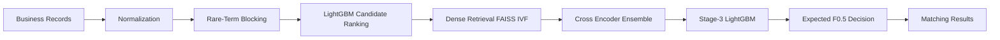
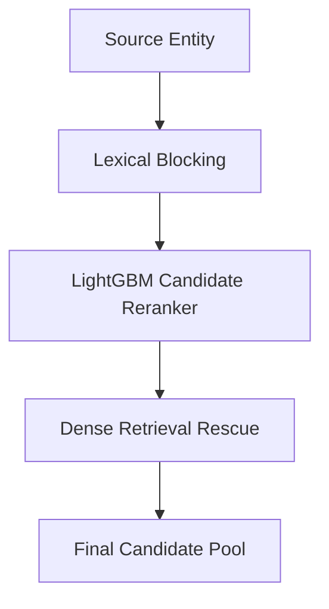

# Amazon ML Challenge 2026 Technical Documentation

This Markdown report mirrors the PDF and includes Mermaid diagrams for GitHub rendering.

# Amazon ML Challenge 2026 — Business Entity Resolution

## Public Leaderboard Score

**0.987836**

## Solution Overview

This repository contains our Amazon ML Challenge 2026 solution for Business Entity Resolution using a hybrid retrieval and ranking pipeline.

### End-to-End Pipeline

## Candidate Generation Strategy

## Architecture

## Technical Highlights

| Stage | Implementation |
|------|----------------|
| Normalization | Unicode folding, legal-form normalization, Indic romanization, address normalization |
| Blocking | Rare-term inverted index, consonant skeletons, phonetic keys |
| Candidate Reranking | Cross-fitted LightGBM |
| Dense Retrieval | Fine-tuned multilingual-e5-large + FAISS IVF |
| Matching | Country-specific LightGBM experts |
| Re-ranking | Eight multilingual cross encoders |
| Ensemble | Stage-3 LightGBM combiner |
| Decision | Expected macro F0.5 optimization with abstention |

## Results

| Version | Public LB |
|---|---:|
| Initial Stack | 0.95949 |
| Cross Encoder Ensemble | 0.97677 |
| Stage-3 Ensemble | 0.98187 |
| Dense Retrieval | 0.98586 |
| Final Submission | **0.987836** |
